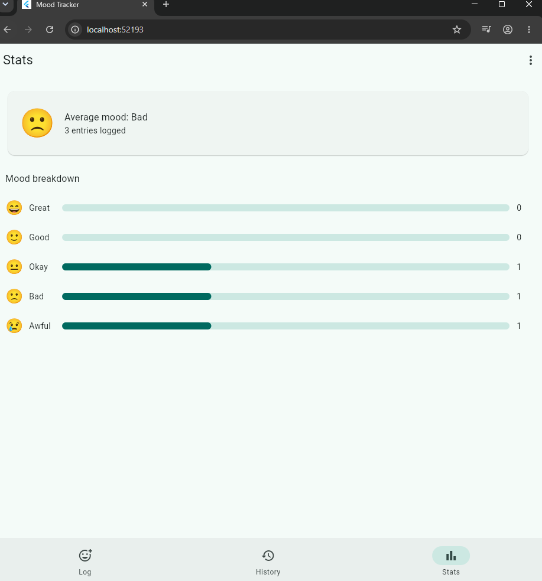

Mood Tracker 😊
A simple, calming mood-tracking application built with Flutter. Mood Tracker helps users check in with their feelings, optionally add a note, review previous mood entries, and view a breakdown of their mood history.
Screenshots
1. Log Mood
Choose how you feel today, add an optional note, and save your mood entry. The screen also displays a motivational quote.

2. Mood History
Review previously saved mood entries, including the mood and the date and time each entry was logged.

3. Mood Statistics


4. Dark Mode Support

Mood Tracker supports both Light Mode and Dark Mode, allowing users to choose their preferred appearance.

- **Light Mode:** Provides a clean and comfortable interface for daytime use.
- **Dark Mode:** Offers a darker interface for comfortable viewing in low-light environments.
- **Easy Switching:** Users can switch between Light and Dark Mode using the theme toggle icon in the app bar.
- **Dynamic Theme:** The theme automatically updates across the Log, History, and Stats screens.

**Dark Mode Preview**


View your average mood, total logged entries, and the breakdown across five mood levels.


> **Screenshot setup:** Create a `screenshots` folder in the project root and add your screenshots using the filenames shown above. If you store screenshots elsewhere, update the image paths in this README.
Features
Daily mood check-in: Select one of five mood levels:
😭 Awful
🙁 Bad
😐 Okay
🙂 Good
😄 Great
Optional notes: Add a short note of up to 200 characters to a mood entry.
Mood history: Browse logged mood entries with their date and time.
Mood statistics: See the average mood, total number of entries, and a mood-by-mood breakdown.
Motivational quote: View an inspirational quote on the Log screen.
Bottom navigation: Switch between Log, History, and Stats.
Simple interface: A clean, light design with a calm green/teal colour palette.
Built With
Flutter — UI toolkit for building cross-platform applications.
Dart — programming language used by Flutter.
Getting Started
Prerequisites
Install the following before running the project:
Flutter SDK
Dart SDK (included with Flutter)
An editor such as Visual Studio Code or Android Studio
A browser or emulator/device supported by Flutter
Installation
Clone this repository:
```bash
   git clone <YOUR_REPOSITORY_URL>
   ```
Move into the project directory:
```bash
   cd <YOUR_PROJECT_FOLDER>
   ```
Install dependencies:
```bash
   flutter pub get
   ```
Run the application:
```bash
   flutter run
   ```
To run it in Chrome, if web support is enabled:
```bash
   flutter run -d chrome
   ```
How to Use
Open the Log screen.
Select the mood that best describes how you feel.
Optionally enter a note.
Tap Save mood.
Open History to review logged entries.
Open Stats to view your average mood and mood breakdown.
Project Structure
A typical Flutter project structure includes:
```text
your-project/
├── lib/              # Application source code
├── test/             # Automated tests
├── web/              # Web platform files
├── windows/          # Windows platform files
├── pubspec.yaml      # Project metadata and dependencies
└── README.md         # Project documentation
```
Your actual project may contain additional folders and files.
Current Scope
This README describes the functionality visible in the supplied screenshots. The screenshots show mood logging, optional notes, history, statistics, a motivational quote, and bottom navigation. Data persistence, authentication, cloud synchronisation, and the source of the quote are not specified here because they cannot be confirmed from the screenshots alone.
Future Improvements
Possible enhancements include:
Mood trends over longer periods
Calendar-based mood history
Exporting mood entries
Optional reminders to check in
Data backup and synchronisation
License
No license has been specified yet. Add a license if you want to define how others may use, modify, and distribute this project.
